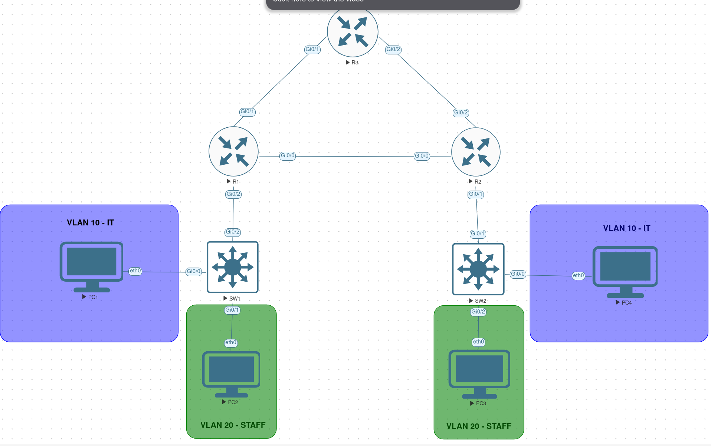

# Lab 02 — VLANs, Inter-VLAN Routing, OSPF and Failover

## 1. Overview

This lab demonstrates how to connect two office networks using VLANs, inter-VLAN routing, and OSPF dynamic routing.

The environment was built in **EVE-NG**, running as a virtual machine on Fedora Linux using KVM/QEMU.

The scenario simulates two company offices connected through three routers. R1 and R2 provide connectivity between the offices, while R3 provides an alternative path in case the direct connection fails.

**Objective:** Configure VLANs in both offices, establish dynamic routing using OSPF, and verify that communication continues through an alternative path after a link failure.

## 2. Technologies Used

- EVE-NG 7.4
- Cisco IOSv 15.9(3)M6
- Cisco IOSvL2 switches
- Cisco IOS CLI
- VPCS virtual hosts
- IPv4 addressing and subnetting
- VLANs and 802.1Q trunking
- Inter-VLAN routing (Router-on-a-Stick)
- OSPF dynamic routing
- Network redundancy and failover

## 3. Network Topology



The topology consists of three Cisco routers, two Layer 2 switches, and four virtual PCs.

- **R1** connects Office A to the routed network.
- **R2** connects Office B to the routed network.
- **R3** provides an alternative route between R1 and R2.
- **SW1 and SW2** separate office devices into VLANs 10 and 20.

All three routers are connected in a triangle, allowing OSPF to select another path if one of the router links fails.

## 4. IP Addressing Plan

### Router Connections

| Device | Interface | IP Address | Description |
| ------ | --------- | ---------- | ----------- |
| R1 | Gi0/0 | 10.0.12.1/30 | Connection to R2 |
| R1 | Gi0/1 | 10.0.13.1/30 | Connection to R3 |
| R2 | Gi0/0 | 10.0.12.2/30 | Connection to R1 |
| R2 | Gi0/2 | 10.0.14.2/30 | Connection to R3 |
| R3 | Gi0/1 | 10.0.13.2/30 | Connection to R1 |
| R3 | Gi0/2 | 10.0.14.1/30 | Connection to R2 |

### VLAN Networks

| Device | Interface | VLAN | IP Address | Description |
| ------ | --------- | ---- | ---------- | ----------- |
| R1 | Gi0/2.10 | 10 | 192.168.10.1/24 | Office A — IT gateway |
| R1 | Gi0/2.20 | 20 | 192.168.20.1/24 | Office A — STAFF gateway |
| R2 | Gi0/1.10 | 10 | 192.168.30.1/24 | Office B — IT gateway |
| R2 | Gi0/1.20 | 20 | 192.168.40.1/24 | Office B — STAFF gateway |

VLAN 10 is used for IT and VLAN 20 for STAFF. Each office uses different IP subnets.

Inter-VLAN routing is configured using router subinterfaces and 802.1Q trunks.

The device configurations are available in the [configs](configs/) directory.

## 5. Verification

The following Cisco IOS commands were used to verify the network:

```text
show vlan brief
show interfaces trunk
show ip interface brief
show ip ospf neighbor
show ip route ospf
```

### VLAN and Trunk Verification

On SW1 and SW2, I verified that VLANs 10 and 20 were active and the correct access ports were assigned to each VLAN.

I also verified that the connections between the switches and routers were operating as 802.1Q trunks.

**Result:** Both switches had working trunk connections carrying VLANs 10 and 20.

[Switch Verification Results](verifications/switches.txt)

### OSPF Verification

OSPF process 1 was configured on R1, R2, and R3 using area 1.

The following command was used to check OSPF neighbor relationships:

```text
show ip ospf neighbor
```

**Result:** All three routers successfully established OSPF adjacencies with their directly connected router neighbors.

The routing tables were checked using:

```text
show ip route ospf
```

R1 learned the Office B networks (`192.168.30.0/24` and `192.168.40.0/24`) through OSPF.

R2 learned the Office A networks (`192.168.10.0/24` and `192.168.20.0/24`) through OSPF.

[OSPF Verification Results](verifications/ospf_verify.txt)

## 6. Troubleshooting Exercise — OSPF Failover

To simulate a network failure, the direct connection between R1 and R2 was temporarily disabled.

Before the failure, R1 reached the Office B network `192.168.30.0/24` through R2 using `10.0.12.2` as the next hop.

The interface on R1 was shut down:

```text
configure terminal
interface GigabitEthernet0/0
shutdown
end
```

After the link went down, the routing table was inspected:

```text
show ip route 192.168.30.0
```

OSPF automatically selected an alternative route through R3.

| | Before Failure | After Failure |
| ------ | ------ | ------ |
| Next hop | 10.0.12.2 (R2) | 10.0.13.2 (R3) |
| Outgoing interface | Gi0/0 | Gi0/1 |
| OSPF metric | 2 | 3 |
| Path | R1 → R2 | R1 → R3 → R2 |

### Connectivity Verification

Traceroute was performed from PC2 to a host in Office B:

```text
trace 192.168.30.30
```

Before the failure, traffic used the direct R1–R2 connection.

After the failure, traceroute showed that packets were forwarded through R3 before reaching R2.

**Result:** OSPF successfully switched to the alternative path, and connectivity was maintained after reconvergence.

The direct connection was then restored:

```text
configure terminal
interface GigabitEthernet0/0
no shutdown
end
```

[Full Failover Test Results](verifications/failover.txt)

**Troubleshooting takeaway:** Dynamic routing protocols such as OSPF can automatically calculate an alternative path when a network link fails. However, connectivity may be temporarily interrupted while the routers detect the failure and update their routing tables.

## 7. Key Takeaways

This lab helped reinforce several networking concepts:

1. VLANs separate devices into different Layer 2 broadcast domains.
2. Router-on-a-Stick allows communication between VLANs using 802.1Q subinterfaces.
3. OSPF allows routers to learn remote networks dynamically without manually configuring static routes.
4. OSPF neighbor relationships and routing tables are important for verifying dynamic routing.
5. Redundant connections allow traffic to use an alternative path after a link failure.
6. Routing tables and traceroute help identify which path packets take through the network.
7. Network verification should include testing both normal operation and failure scenarios.
