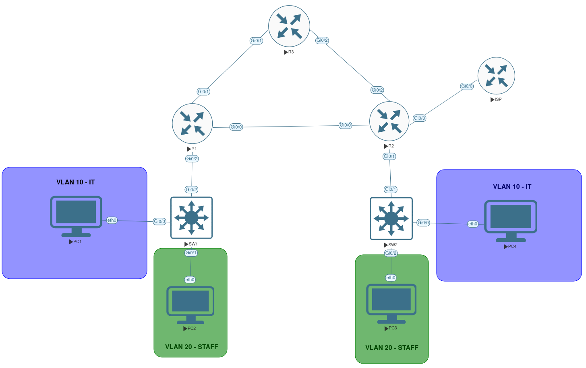

# Lab 03 — Enterprise NAT, ACLs, OSPF and Failover

## 1. Overview

This lab builds on Lab 02 by adding a simulated ISP connection, Network Address Translation (NAT/PAT), and extended access control lists (ACLs) to a network with two offices.

The environment was built in **EVE-NG**, running as a virtual machine on Fedora Linux using KVM/QEMU.

The scenario simulates two company offices connected through three routers. R1 connects Office A, R2 connects Office B and provides access to the simulated ISP, and R3 offers an alternative path if the direct R1–R2 link fails.

**Objective:** Allow both offices to access a simulated external network using PAT, restrict STAFF access to IT networks using extended ACLs, and verify that ISP connectivity can continue through an alternative OSPF path after a link failure.

## 2. Technologies Used

- EVE-NG 7.4
- Cisco IOSv 15.9(3)M6
- Cisco IOSvL2 switches
- Cisco IOS CLI
- VPCS virtual hosts
- IPv4 addressing and subnetting
- VLANs and 802.1Q trunking
- Inter-VLAN routing (Router-on-a-Stick)
- OSPF dynamic routing and default route advertisement
- NAT overload (PAT)
- Extended access control lists (ACLs)
- Network redundancy and failover

## 3. Network Topology



The topology consists of four Cisco routers (including the simulated ISP), two Layer 2 switches, and four virtual PCs.

- **R1** connects Office A and provides the default gateways for its VLANs.
- **R2** connects Office B, performs PAT, and connects the internal network to ISP.
- **R3** provides an alternative route between R1 and R2.
- **ISP** simulates an external network using loopback address `203.0.113.10/32`.
- **SW1 and SW2** connect office devices in VLAN 10 (IT) and VLAN 20 (STAFF).

R1, R2, and R3 form a triangle and run OSPF area 1. ISP is not part of OSPF. R2 advertises a default route into the internal OSPF network.

The ISP connection is simulated in EVE-NG; it does not provide access to the public Internet.

## 4. IP Addressing Plan

### Router and ISP Connections

| Device | Interface | IP Address | Description |
|---|---|---|---|
| R1 | Gi0/0 | 10.0.12.1/30 | Connection to R2 |
| R1 | Gi0/1 | 10.0.13.1/30 | Connection to R3 |
| R2 | Gi0/0 | 10.0.12.2/30 | Connection to R1 |
| R2 | Gi0/2 | 10.0.14.2/30 | Connection to R3 |
| R3 | Gi0/1 | 10.0.13.2/30 | Connection to R1 |
| R3 | Gi0/2 | 10.0.14.1/30 | Connection to R2 |
| R2 | Gi0/3 | 198.51.100.1/30 | NAT outside interface, connection to ISP |
| ISP | Gi0/0 | 198.51.100.2/30 | Connection to R2 |
| ISP | Loopback0 | 203.0.113.10/32 | Simulated external destination |

### VLAN Networks

| Device | Interface | VLAN | IP Address | Description |
|---|---|---|---|---|
| R1 | Gi0/2.10 | 10 | 192.168.10.1/24 | Office A — IT gateway |
| R1 | Gi0/2.20 | 20 | 192.168.20.1/24 | Office A — STAFF gateway |
| R2 | Gi0/1.10 | 10 | 192.168.30.1/24 | Office B — IT gateway |
| R2 | Gi0/1.20 | 20 | 192.168.40.1/24 | Office B — STAFF gateway |

Both offices use VLAN 10 for IT and VLAN 20 for STAFF, but each VLAN has a separate IP subnet in each office.

The device configurations are available in the [configs](configs/) directory.

## 5. Verification

The following Cisco IOS commands were used to verify routing, NAT, and ACL operation:

```text
show ip route
show ip route ospf
show ip nat translations
show ip nat statistics
show access-lists 1
show access-lists 101
```

### Default Routing and OSPF Verification

R2 uses a static default route toward ISP (`198.51.100.2`) and advertises the default route into OSPF using `default-information originate`.

R1 learned an OSPF external default route (`O*E2`) through R2 with next hop `10.0.12.2` during normal operation.

**Result:** Office A and Office B have a route toward the simulated ISP through R2.

[Routing Verification Results](verifications/routing.txt)

### NAT/PAT Verification

PAT was configured on R2 using its outside interface `Gi0/3` (`198.51.100.1`). NAT ACL 1 selects all four internal office networks for translation.

The translation table was inspected after generating traffic from the PCs toward `203.0.113.10`:

```text
show ip nat translations
show ip nat statistics
```

**Result:** The translation table showed hosts from all four internal networks using `198.51.100.1` as their inside global address. NAT statistics showed active dynamic translations and translation hits.

[NAT Verification Results](verifications/nat.txt)

### Extended ACL Verification

Extended ACL 101 was configured inbound on the STAFF router subinterfaces:

- **R1 `Gi0/2.20`:** Block `192.168.20.0/24` from accessing the IT networks `192.168.10.0/24` and `192.168.30.0/24`.
- **R2 `Gi0/1.20`:** Block `192.168.40.0/24` from accessing the same two IT networks.

Other IP traffic from those STAFF networks is permitted by the final ACL entries, including traffic toward the simulated ISP.

The ACL counters were checked using:

```text
show access-lists 101
```

**Result:** Both routers showed matches on their deny rules and permit rules, confirming that the ACL entries were processing traffic.

These are stateless ACLs, so they can also block return traffic from STAFF to IT hosts even when an IT host initiated the connection.

[ACL Verification Results](verifications/acl.txt)

## 6. Troubleshooting and Failover Testing

### NAT Troubleshooting — Office B Connectivity

During configuration, PC3 in Office B could reach its default gateway and R2's outside interface, but could not communicate with the simulated ISP.

I checked local connectivity, routing, NAT translations, NAT statistics, and ACL rules.

**Root cause:** The `ip nat inside` command was missing on R2's VLAN subinterfaces `Gi0/1.10` and `Gi0/1.20`.

After configuring those subinterfaces as NAT inside interfaces, communication from Office B to the simulated ISP worked.

**Troubleshooting takeaway:** With Router-on-a-Stick, the VLAN subinterfaces are the Layer 3 interfaces that receive the traffic. NAT inside and outside roles must be assigned to the correct interfaces.

### OSPF Failover with Simulated ISP Access

To simulate a network failure, the direct connection between R1 and R2 was temporarily disabled.

On R1:

```cisco
configure terminal
interface GigabitEthernet0/0
shutdown
end
```

The default route on R1 and a traceroute from PC1 to the ISP loopback were compared before and after the failure.

| | Before Failure | After Failure |
|---|---|---|
| Default route next hop on R1 | 10.0.12.2 (R2) | 10.0.13.2 (R3) |
| Outgoing interface on R1 | Gi0/0 | Gi0/1 |
| Path to ISP | R1 → R2 → ISP | R1 → R3 → R2 → ISP |

From PC1:

```text
trace 203.0.113.10
```

Before the failure, traceroute passed through R2 directly. After the failure, it passed through R3 (`10.0.13.2`) and then R2 (`10.0.14.2`) before reaching ISP.

**Result:** OSPF recalculated the route after the direct link failed. The routing table and traceroute confirmed the alternative path toward the simulated ISP.

The direct connection was then restored:

```cisco
configure terminal
interface GigabitEthernet0/0
no shutdown
end
```

[Full Failover Test Results](verifications/failover.txt)

**Troubleshooting takeaway:** OSPF can provide an alternative path to the network edge when an internal link fails. NAT and routing must both be configured correctly for office hosts to reach the simulated ISP.

## 7. Key Takeaways

This lab helped reinforce several networking concepts:

1. PAT allows multiple private IP addresses to share one outside IP address.
2. NAT inside and outside interfaces must be configured correctly, especially when using VLAN subinterfaces.
3. Extended ACLs can restrict traffic between departments while allowing other destinations.
4. ACL rule order matters because the first matching entry determines how a packet is handled.
5. OSPF can distribute a default route from the edge router to the internal network.
6. Redundant router connections allow traffic to follow an alternative path after a link failure.
7. NAT translation tables, ACL match counters, routing tables, and traceroute are useful troubleshooting tools.
8. Testing normal operation and failure scenarios helps verify how the network behaves in practice.
